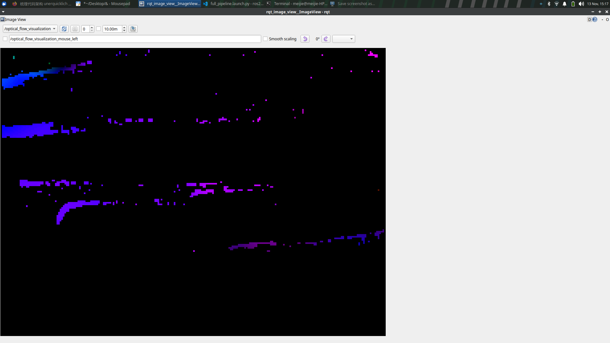
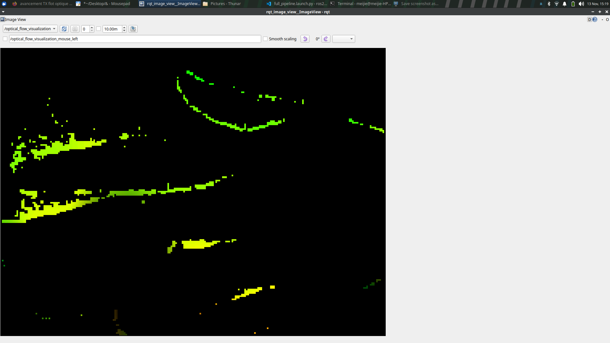

# Real-Time Optical Flow for Event Cameras — ROS2 Jazzy

This branch contains a ROS2 Jazzy migration of the original project **Real-Time Optical Flow for Vehicular Perception with Low- and High-Resolution Event Cameras**.


The original implementation was developed by **Vincent Brebion, Julien Moreau, and Franck Davoine**. It computes optical flow from event-camera data using an optimized pipeline based on an *inverse exponential distance surface*.

The original ROS1 implementation is available on the [`master` branch](https://github.com/heudiasyc/rt_of_low_high_res_event_cameras/tree/master).

## ROS2 Migration

The implementation has been adapted to **ROS2 Jazzy** on **Ubuntu 24.04**, with GPU acceleration using CUDA.

The migrated pipeline follows four processing stages:

1. **Events Accumulation** — converts asynchronous events into an edge image.
2. **Denoising & Filling** — processes the accumulated edge image.
3. **Distance Transform** — computes the distance surface.
4. **Optical Flow Computation** — estimates optical flow using GPU acceleration.

The ROS2 implementation is organized into three packages:

- `rt_of_event_msgs` — custom event message definitions.
- `davis_event_adapter` — adapter for DAVIS event-camera messages.
- `rt_of_ros2` — main optical flow processing pipeline.

The ROS2 packages are located in the [`ros2/` directory](ros2/).

## Validation

The migrated pipeline has been tested using:

- **Checkerboard dataset replay:** ROS2 bag playback at 1.0× speed, with 1280 × 720 event data.
- **DAVIS240C live camera:** real-time event processing and color-coded optical flow visualization.
- **DSEC dataset:** native HDF5 event replay at 640 × 480, with optional event rectification.

During the checkerboard replay test, the observed optical flow publication rate was approximately **57.6 FPS**.

### DAVIS240C Optical Flow Visualization

The following screenshots show the optical flow generated when a hand moves vertically in front of the DAVIS240C camera.

| Upward movement | Downward movement |
|:---:|:---:|
|  |  |
| Predominantly purple | Predominantly yellow |

The visualization uses color to represent optical flow direction and brightness to represent motion magnitude.

### DSEC Optical Flow Demonstration

The ROS2 implementation supports native HDF5 replay of the DSEC dataset, with optimized event accumulation and optional event rectification.

The complete `interlaken_00_b` sequence was successfully processed:

- Resolution: 640 × 480
- Accumulation window: 25 ms
- Configured replay rate: 1.0×
- Processed events: 1,546,817,686
- Published optical flow frames: 3,231

[Download the DSEC demonstration video (MP4, 32.3 MB)](docs/DSEC_25ms_ROS2_demo.mp4)

## Documentation

- **[ROS2 Installation and Usage Guide](ros2/README.md)** — dependencies, compilation, checkerboard and DSEC replay, and live DAVIS240C demonstration.
- **[ROS2 Migration Report](docs/ROS2_MIGRATION_REPORT.md)** — architecture, migration process, technical challenges, and experimental results.
- **[Color Optical Flow Visualization Script](ros2/tools/visualize_optical_flow.py)** — ROS2 visualization utility.

## Original Publication

If you use the original algorithm or code in your work, please cite:

```bibtex
@article{Brebion2022RealTimeOF,
  title={Real-Time Optical Flow for Vehicular Perception With Low- and High-Resolution Event Cameras},
  author={Vincent Brebion and Julien Moreau and Franck Davoine},
  journal={IEEE Transactions on Intelligent Transportation Systems},
  year={2022},
  volume={23},
  number={9},
  pages={15066-15078}
}
```

The original repository also provides information about the [High-Speed High-Definition Event-Based Indoor Dataset](https://datasets.hds.utc.fr/share/er2aA4R0QMJzMyO).

## Notes

This branch focuses on the ROS2 migration and its validated functionality. The original ROS1 implementation is preserved on the `master` branch.

Additional functionality available in the original ROS1 implementation should not be assumed to have been migrated unless explicitly documented.

The original project license is preserved in [`LICENSE`](LICENSE).
