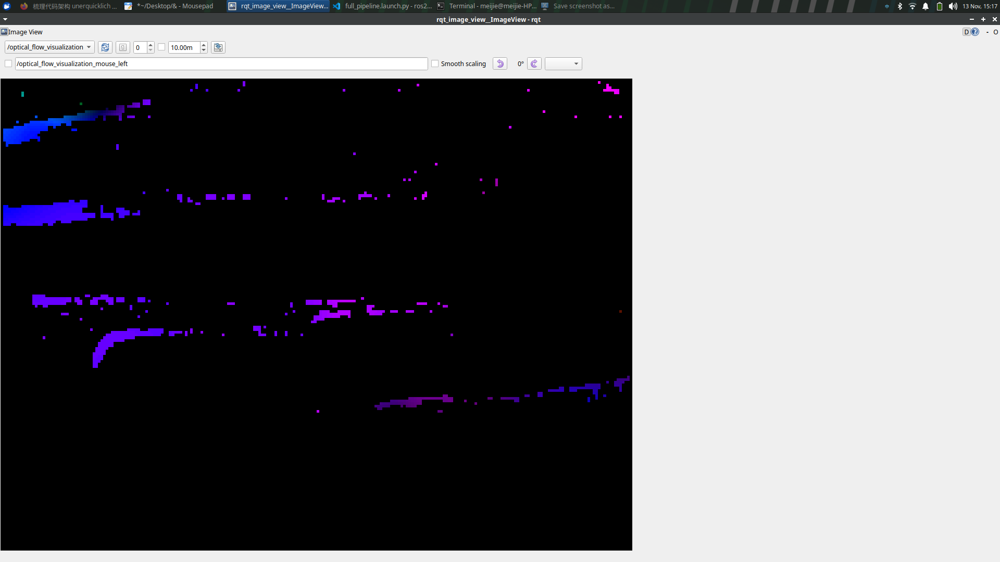
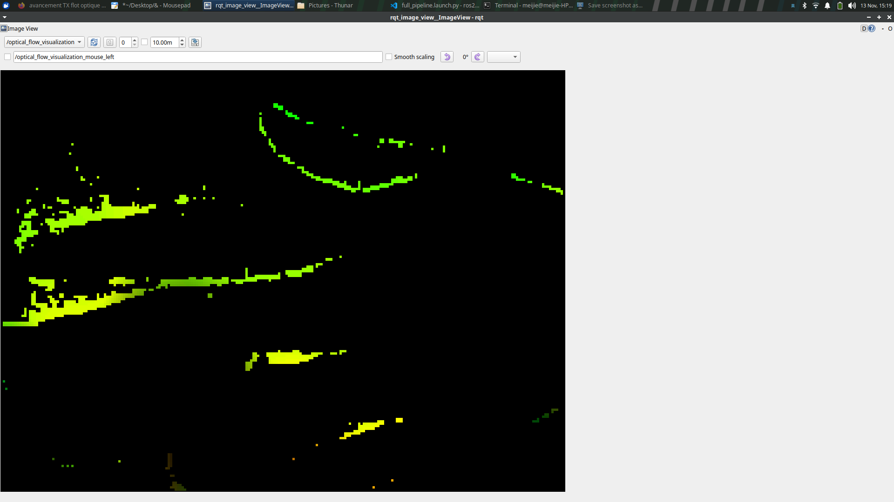

# ROS1 to ROS2 Jazzy Migration Report

## 1. Project Overview

This project migrates the real-time optical flow pipeline for event cameras from ROS1 to ROS2 Jazzy.

The migration is based on the original implementation of *Real-Time Optical Flow for Vehicular Perception with Low- and High-Resolution Event Cameras* by Vincent Brebion, Julien Moreau, and Franck Davoine.

The original ROS1 implementation remains available on the `master` branch, while the ROS2 implementation is maintained separately under the `ros2/` directory of the `ros2` branch.

The main objective is to preserve the original four-stage processing architecture while adapting the software to the ROS2 communication system, build environment, and GPU dependencies.

The migration was developed and validated on Xubuntu 24.04 with an NVIDIA Quadro RTX 5000 GPU and CUDA Toolkit 12.6.

## 2. Architecture Migration

The optical flow pipeline consists of four processing stages.

### 2.1 Events Accumulation

**ROS2 node:** `events_accumulation_node`

This module receives asynchronous events from the event camera and accumulates them within a configurable time window.

The accumulated events are converted into an image representation for subsequent processing.

In the validated configuration, the accumulation window was set to 15 ms.

### 2.2 Denoising and Filling

**ROS2 node:** `denoising_filling_node`

This module processes the accumulated event image to reduce noise and fill relevant regions.

The migrated implementation supports GPU processing.

During validation, the node was initialized with the following parameters:

- Processing mode: GPU
- `nd = 2`
- `nf = 3`

### 2.3 Distance Transform

**ROS2 node:** `distance_surface_original_node`

This module computes a distance-based representation from the processed event image.

The validated configuration used GPU processing with the exponential formulation.

The output is published as a ROS2 image message for the optical flow module.

### 2.4 Optical Flow Computation

**ROS2 node:** `optical_flow_gpu_node`

The final module computes optical flow from the distance surface using GPU acceleration.

The migrated implementation uses the external `optical-flow-filter` GPU library.

The validated configuration used three processing levels and produced optical flow frames at a resolution of 1280 × 720.

### 2.5 ROS2 Communication Architecture

The four modules communicate through ROS2 topics.

The validated processing chain is:

```text
Event camera / ROS2 event dataset
               |
               v
    events_accumulation_node
               |
               v
          /edge_image
               |
               v
     denoising_filling_node
               |
               v
  /denoised_filled_edge_image
               |
               v
 distance_surface_original_node
               |
               v
    /distance_surface_original
               |
               v
       optical_flow_gpu_node
               |
               v
          /optical_flow
```

The image-processing stages exchange `sensor_msgs/msg/Image` messages.

The event input uses the custom ROS2 message type `rt_of_event_msgs/msg/EventArray`.

For live DAVIS240C operation, a separate `davis_event_adapter` package provides event-message adaptation before the events enter the processing pipeline.

### 2.6 Optimized DSEC Replay Architecture

The initial DSEC implementation reads HDF5 event data and publishes ROS2 EventArray messages before event accumulation. However, this architecture introduces substantial communication and serialization overhead when processing high-density event sequences.

To reduce this overhead, HDF5 reading and event accumulation were integrated into a single node, `events_h5_edges_node`.

```text
DSEC events.h5
      |
      v
events_h5_edges_node
  - Chunked HDF5 reading
  - Optional event rectification
  - Direct event accumulation
      |
      v
/edge_image
      |
      v
Denoising and Filling
      |
      v
Distance Transform
      |
      v
GPU Optical Flow
```

The optimized implementation reads up to eight million events per chunk. Only event coordinates and timestamps are loaded during processing, since polarity is not required for binary edge image generation.

The downstream processing stages remain unchanged.

Two reusable components were introduced:

- `event_accumulator.hpp`: event accumulation and binary edge image generation.
- `rectification_h5.hpp`: HDF5 rectification map loading and coordinate mapping preparation.

Both components are independent of ROS communication interfaces, providing an initial foundation for future standalone development.

## 3. Technical Challenges and Solutions

### 3.1 ROS1 and ROS2 Communication Differences

**Challenge**

The original project was developed for ROS1. Its communication mechanisms and build configuration could not be transferred directly to ROS2 Jazzy.

**Solution**

The processing stages were implemented as ROS2 nodes using ROS2 publishers, subscribers, and parameters.

The complete processing pipeline can now be started through a ROS2 launch file:

```bash
ros2 launch rt_of_ros2 full_pipeline.launch.py
```

**Validation**

All four processing nodes started successfully in a separate ROS2 workspace.

### 3.2 Custom Event Message Migration

**Challenge**

The original dataset uses event-camera messages that require compatible message definitions in ROS2.

**Solution**

A dedicated ROS2 package, `rt_of_event_msgs`, was created to provide the required `Event` and `EventArray` message definitions.

A separate package, `davis_event_adapter`, was also included for event-camera message adaptation.

**Validation**

The ROS2 pipeline successfully processed the converted checkerboard event dataset.

The DAVIS event adapter was also used during the live camera demonstration.

### 3.3 CUDA Compiler Detection

**Challenge**

During the independent release build, CMake initially failed to detect the CUDA compiler.

The reported error was:

```text
No CMAKE_CUDA_COMPILER could be found
```

**Solution**

CUDA Toolkit 12.6 was configured explicitly:

```bash
export CUDA_HOME=/usr/local/cuda-12.6
export PATH="$CUDA_HOME/bin:$PATH"
export LD_LIBRARY_PATH="$CUDA_HOME/lib64:${LD_LIBRARY_PATH:-}"
export CUDACXX="$CUDA_HOME/bin/nvcc"
```

The build command also explicitly specified the CUDA compiler and toolkit location.

**Validation**

The independent build completed successfully, and `nvcc --version` confirmed CUDA 12.6.

### 3.4 External GPU Library Integration

**Challenge**

The optical flow module depends on the external `optical-flow-filter` GPU library.

During development, the build initially encountered a missing CUDA header:

```text
fatal error: cuda.h: No such file or directory
```

The GPU library also needed to be located and linked correctly.

**Solution**

The CUDA include paths and external GPU library location were configured in the build environment.

The ROS2 CMake configuration supports an explicit `FLOWFILTER_ROOT` parameter.

For example:

```bash
-DFLOWFILTER_ROOT=/absolute/path/to/optical-flow-filter
```

**Validation**

The optical flow executable successfully linked to `libflowfilter_gpu.so` and the CUDA runtime.

The GPU optical flow node subsequently initialized and published flow frames.

### 3.5 ROS2 Dataset Compatibility

**Challenge**

The original checkerboard dataset was stored in ROS1 bag format and could not be used directly as an ordinary ROS2 bag.

**Solution**

A ROS2-compatible version of the checkerboard dataset was prepared.

The converted dataset was used to test the processing pipeline.

**Validation**

The complete ROS2 pipeline processed the event data and generated 1280 × 720 optical flow frames.

### 3.6 Independent Build Verification

**Challenge**

A successful build in the original development workspace does not necessarily demonstrate that the source files copied into a release repository are complete.

**Solution**

A separate workspace, `rt_of_release_test_ws`, was created.

The three ROS2 packages were linked from the GitHub release directory and rebuilt with the required CUDA and GPU library configuration.

**Validation**

All three packages built successfully:

- `rt_of_event_msgs`
- `davis_event_adapter`
- `rt_of_ros2`

The complete pipeline was then launched from this independent workspace and tested with real event data.

This verification reduces the risk of accidentally relying on source files that exist only in the original development workspace.

### 3.7 Optional HDF5 Integration

Native DSEC replay requires the HDF5 C++ library and the Blosc compression filter.

To avoid introducing a mandatory dependency for users who only require live camera input or ROS2 bag replay, HDF5 support is controlled by the `ENABLE_HDF5` CMake option.

An independent build was performed with:

```bash
-DENABLE_HDF5=OFF
```

All three ROS2 packages compiled successfully in 18.6 seconds.

The seven non-HDF5 executables remained available, while `events_h5_node` and `events_h5_edges_node` were excluded.

This experiment validates the optional build configuration. The test was conducted on a system with HDF5 installed, rather than on an HDF5-free system.

## 4. Experimental Validation

### 4.1 Test Environment

| Component | Configuration |
|---|---|
| Operating system | Xubuntu 24.04 |
| ROS distribution | ROS2 Jazzy |
| GPU | NVIDIA Quadro RTX 5000 |
| CUDA Toolkit | 12.6 |
| Dataset | Converted checkerboard ROS2 bag |
| Image resolution | 1280 × 720 |
| Dataset playback rate | 1.0× |

The checkerboard dataset was used for quantitative measurements. A separate live demonstration was conducted using a DAVIS240C event camera.

### 4.2 Pipeline Startup

The following four nodes were confirmed to be running:

```text
/events_accumulation_node
/denoising_filling_node
/distance_surface_original_node
/optical_flow_gpu_node
```

The expected intermediate and output topics were also present.

### 4.3 Optical Flow Output

The GPU optical flow node successfully published frames at a resolution of 1280 × 720.

The observed execution logs included frames 984–988, confirming that the pipeline continued processing beyond initialization.

### 4.4 Optical Flow Publication Frequency

The publication frequency was measured using:

```bash
ros2 topic hz /optical_flow
```

Selected measurements were:

| Measurement window | Average publication rate |
|---|---:|
| 232 messages | 57.026 FPS |
| 458 messages | 56.233 FPS |
| 692 messages | 56.737 FPS |
| 876 messages | 57.563 FPS |

The final observed cumulative-window measurement was approximately **57.56 FPS**.

This value represents the measured ROS2 topic publication frequency, not the theoretical maximum GPU computation rate.

### 4.5 GPU Optical Flow Computation Time

Selected GPU computation measurements were:

| Frame | Computation time |
|---|---:|
| 984 | 8.035518 ms |
| 985 | 7.986675 ms |
| 986 | 7.974930 ms |
| 987 | 7.881018 ms |
| 988 | 8.017087 ms |

The mean computation time across these five samples was approximately **7.98 ms**.

These measurements represent a small consecutive sample and should not be interpreted as the average performance of the entire dataset.

### 4.6 Live DAVIS240C Validation

The ROS2 pipeline was also tested with a DAVIS240C event camera using the `libcaer_driver` and `davis_event_adapter` packages.

During the demonstration, a hand was moved vertically in front of the camera to produce events corresponding to different motion directions.

A Python visualization script, `visualize_optical_flow.py`, was used to convert the computed optical flow into a color-coded image.

The visualization uses HSV color space:

- **Hue** represents optical flow direction.
- **Saturation** is fixed at its maximum value.
- **Brightness** represents optical flow magnitude.

The visualization subscribes to `/optical_flow` and publishes the resulting color image on `/optical_flow_visualization`.

Two screenshots were recorded during the demonstration:

| Upward hand movement | Downward hand movement |
|:---:|:---:|
|  |  |
| Predominantly purple optical flow | Predominantly yellow optical flow |

The observed color differences illustrate how the visualization distinguishes different motion directions.

This experiment provides qualitative evidence that the migrated pipeline can process live DAVIS240C event data and generate optical flow visualization.

However, a detailed quantitative performance evaluation with live camera input has not yet been conducted.

### 4.7 DSEC Accumulation Window Evaluation

The original ROS1 implementation uses an event accumulation window of 100 ms for the DSEC dataset. However, experiments conducted on the `interlaken_00_b` sequence revealed that this configuration may lead to excessive event accumulation in high-density scenes.

Three accumulation windows were evaluated using the first 20 seconds of the same sequence at a resolution of 640 × 480 and a replay rate of 1.0. Each experiment processed 538,654,788 events, with no invalid event coordinates detected.

| Accumulation window | 100 ms | 50 ms | 25 ms |
|---|---:|---:|---:|
| Theoretical output frequency | 10 Hz | 20 Hz | 40 Hz |
| Measured edge image frequency | 9.265 Hz | 17.469 Hz | 33.012 Hz |
| Measured distance surface frequency | 9.408 Hz | 17.514 Hz | 33.755 Hz |
| Subscriber-measured optical flow frequency | 7.370 Hz | 12.015 Hz | 14.688 Hz |
| Published optical flow frames | 199 | 399 | 799 |

With the original 100 ms accumulation window, the high event density resulted in thick and overlapping object boundaries, particularly in vegetation and other highly textured regions. In some frames, more than 80% of the pixels in the binary edge image were activated. This excessive accumulation may reduce spatial discrimination in the distance surface and contribute to large aggregated color regions and dark areas in the optical flow visualization.

Reducing the accumulation window to 25 ms improved temporal resolution, visual continuity, and the distinguishability of object boundaries. Among the three tested configurations, the 25 ms window provided the smoothest visual results.

Consequently, 25 ms was selected as the default accumulation window for DSEC replay in the ROS2 implementation. The original 100 ms configuration remains available through the launch parameter.

The reported topic frequencies represent subscriber-side measurements and should not be interpreted as direct measurements of GPU computational throughput. Furthermore, the visual improvements are qualitative; quantitative optical flow accuracy has not yet been evaluated against ground-truth data.

### 4.8 Complete DSEC Sequence Validation

The complete `interlaken_00_b` sequence was processed using the optimized HDF5 replay architecture without event rectification.

| Metric | Result |
|---|---:|
| Image resolution | 640 × 480 |
| Accumulation window | 25 ms |
| Configured replay rate | 1.0× |
| Processed events | 1,546,817,686 |
| Invalid raw event coordinates | 0 |
| Edge images generated | 3,231 |
| Denoising and filling frames | 3,231 |
| Distance surface frames | 3,231 |
| Optical flow frames published | 3,231 |
| Events in the final incomplete window | 278,709 |

The final incomplete accumulation window was not published, consistent with the original window-based processing behavior.

The matching frame counts indicate that no frame-count loss was observed between the processing stages during this experiment.

The final three GPU optical flow computation measurements were:

| Frame | Computation time |
|---|---:|
| 3229 | 6.288 ms |
| 3230 | 6.417 ms |
| 3231 | 6.397 ms |
| Mean of the three samples | 6.368 ms |

These measurements represent a small sample rather than the average computational performance of the complete sequence.

The complete demonstration recording lasted approximately 83 seconds. This recording duration should not be interpreted as a precise measurement of end-to-end processing time.

[Download the DSEC optical flow demonstration video](DSEC_25ms_ROS2_demo.mp4).

### 4.9 Optional Event Rectification Validation

The original HDF5-based event rectification mechanism was adapted to the ROS2 implementation.

The rectification map is loaded once during initialization. Each event coordinate is mapped to its rectified position before edge image generation. Events mapped outside the image boundaries are excluded from the image without affecting the accumulation-window timing.

Two five-second experiments were conducted using the same DSEC sequence and a 25 ms accumulation window.

| Metric | Without rectification | With rectification |
|---|---:|---:|
| Published optical flow frames | 199 | 199 |
| Events rejected by rectification | 0 | 11,680,837 |
| Final edge image nonzero pixels | 178,239 | 167,823 |
| Final distance surface nonzero pixels | 128,961 | 139,377 |
| Final GPU computation time | 6.471 ms | 6.322 ms |

Both configurations successfully generated optical flow frames.

Rectification is disabled by default and can be enabled through the `calibration_file` launch parameter.

These experiments validate the functional integration of optional event rectification. Quantitative optical flow accuracy has not yet been evaluated against ground-truth data.

### 4.10 Interpretation

The experimental results demonstrate that:

1. The migrated ROS2 packages can be compiled in a separate workspace.
2. All four processing modules can run together.
3. The pipeline can process converted event-camera data.
4. The GPU optical flow module can publish 1280 × 720 frames.
5. The complete system achieves an observed publication rate of approximately 57.56 FPS in the reported checkerboard replay test.
6. The pipeline can also process live DAVIS240C events and produce color-coded optical flow visualization.

A controlled comparison with the original ROS1 implementation would require equivalent hardware, datasets, processing parameters, and measurement methods.

The current validation establishes functional operation of the migrated pipeline under the tested configurations. It does not demonstrate complete feature equivalence with every capability of the original ROS1 implementation.

## 5. Repository Organization

The ROS2 migration is maintained in the dedicated Git branch:

`ros2`

The original ROS1 implementation and documentation are preserved on the master branch. The ros2 branch contains the migrated ROS2 packages, documentation, and visualization tools.

The repository is organized as follows:

```text
README.md
LICENSE
docs/
├── ROS2_MIGRATION_REPORT.md
└── DSEC_25ms_ROS2_demo.mp4
ros2/
├── README.md
├── rt_of_event_msgs/
│   └── msg/
├── davis_event_adapter/
│   └── src/
├── rt_of_ros2/
│   ├── config/
│   ├── cuda/
│   ├── include/
│   │   └── rt_of_ros2/
│   │       ├── event_accumulator.hpp
│   │       └── rectification_h5.hpp
│   ├── launch/
│   ├── src/
│   └── test/
├── tools/
│   └── visualize_optical_flow.py
└── images/
    ├── davis_flow_1.png
    └── davis_flow_2.png
```

The repository root `README.md` provides an overview of the ROS2 migration.

The `ros2/README.md` file contains installation, compilation, checkerboard dataset replay, and live DAVIS240C demonstration instructions.

The present report documents the migration process, technical challenges, and experimental validation.

The external GPU library is built separately and is not included as a compiled binary in the repository.

Large event datasets and generated build artifacts are also excluded.

## 6. Conclusion and Future Work

The ROS1-to-ROS2 Jazzy migration has reached a functional validation milestone.

The migrated implementation preserves the four-stage optical flow processing architecture and successfully operates with GPU acceleration.

Independent compilation, complete pipeline startup, checkerboard dataset playback, optical flow publication, and live DAVIS240C visualization have been verified.

The reported checkerboard replay experiment achieved an observed optical flow publication frequency of approximately **57.56 FPS** at a resolution of 1280 × 720.

The migration also supports native DSEC HDF5 replay, optimized event accumulation, and optional event rectification.

The complete `interlaken_00_b` sequence was successfully processed, generating 3,231 optical flow frames from approximately 1.55 billion events.

The next development stage will focus on separating the core processing algorithms from ROS-specific interfaces to enable standalone execution.

Future work may include:

- Further performance profiling and optimization.
- Quantitative evaluation of the pipeline using live event-camera input.
- More extensive comparisons with the original ROS1 implementation.
- Validation of additional camera models and dataset formats.
- Refactoring the processing algorithms into ROS-independent components.

The final objective of the potential ROS-independent refactoring would be to separate the core algorithms from middleware-specific communication interfaces, while preserving the existing processing behavior.

This future refactoring is not part of the currently validated ROS2 migration.
