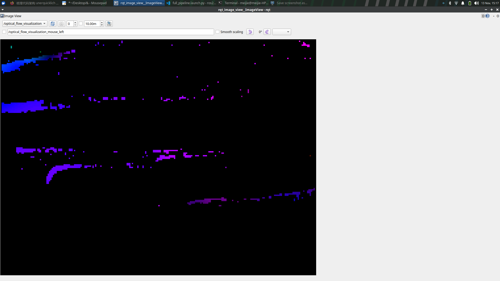
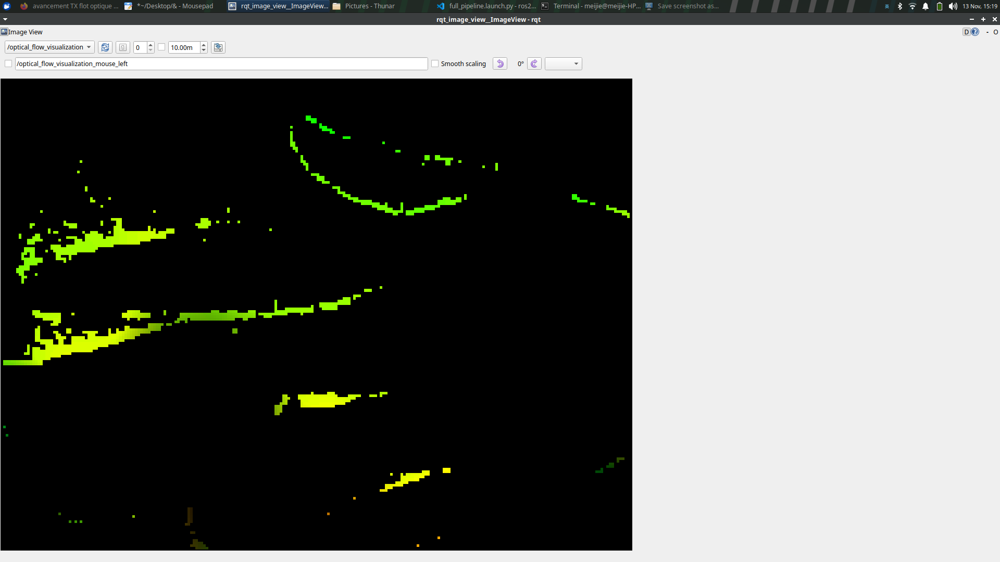

# ROS2 Jazzy Migration

This directory contains the ROS2 Jazzy migration of the
real-time optical flow pipeline for event cameras.

The original ROS1 implementation and documentation are preserved on the master branch. This branch contains the ROS2 migration.

## Environment

The migration was developed and tested with:

- Xubuntu 24.04
- ROS2 Jazzy
- NVIDIA Quadro RTX 5000
- CUDA Toolkit 12.6
- OpenCV
- optical-flow-filter GPU library

The CUDA architecture is currently set to 75 for the Quadro RTX 5000.
Other NVIDIA GPUs may require changing CMAKE_CUDA_ARCHITECTURES.

## ROS2 Packages

- `rt_of_event_msgs`: Event and EventArray message definitions.
- `davis_event_adapter`: Adapter for DAVIS event-camera messages.
- `rt_of_ros2`: Main optical-flow processing pipeline.

## Pipeline

The pipeline consists of four processing stages:

1. Events accumulation
2. Denoising and filling
3. Distance transform
4. Optical flow computation

## External GPU Dependency

The GPU optical-flow node depends on the external
`optical-flow-filter` library.

The library must be built separately.

By default, CMake searches for it at:

    external/optical-flow-filter/

relative to the repository root.

Alternatively, specify its location with:

    -DFLOWFILTER_ROOT=/absolute/path/to/optical-flow-filter

## CUDA Environment

Before building, configure CUDA 12.6:

```bash
export CUDA_HOME=/usr/local/cuda-12.6
export PATH="$CUDA_HOME/bin:$PATH"
export LD_LIBRARY_PATH="$CUDA_HOME/lib64:${LD_LIBRARY_PATH:-}"
export CUDACXX="$CUDA_HOME/bin/nvcc"
```

Verify the CUDA compiler:

```bash
nvcc --version
```

If CMake cannot locate CUDA, specify the compiler explicitly:

```bash
-DCMAKE_CUDA_COMPILER=/usr/local/cuda-12.6/bin/nvcc
-DCUDAToolkit_ROOT=/usr/local/cuda-12.6
```

## Optional HDF5 Dependency

Native DSEC replay requires the HDF5 C++ library and the Blosc compression filter.

On Ubuntu 24.04, install the required dependencies:

```bash
sudo apt install libhdf5-dev hdf5-tools hdf5-filter-plugin-blosc-serial
```

HDF5 support is enabled by default when the library is available.

To explicitly enable or disable HDF5 support, use the corresponding CMake argument:

```bash
-DENABLE_HDF5=ON
```

or:

```bash
-DENABLE_HDF5=OFF
```

If HDF5 is unavailable or disabled, the HDF5 replay executables are excluded from the build. The other ROS2 processing modules remain available.

## Build

Create a separate ROS2 workspace:

    mkdir -p ~/rt_of_jazzy_ws/src

Copy or symlink the three packages from this directory into
the workspace's src directory.

Source ROS2 Jazzy:

    source /opt/ros/jazzy/setup.bash

Build the packages:

    cd ~/rt_of_jazzy_ws

    colcon build --symlink-install \
  	--packages-select rt_of_event_msgs davis_event_adapter rt_of_ros2 \
  	--cmake-args \
  	-DCMAKE_CUDA_COMPILER=/usr/local/cuda-12.6/bin/nvcc \
  	-DCUDAToolkit_ROOT=/usr/local/cuda-12.6 \
  	-DFLOWFILTER_ROOT=/absolute/path/to/optical-flow-filter
Source the workspace:

    source install/setup.bash

## Launch

The complete pipeline can be started with:

    ros2 launch rt_of_ros2 full_pipeline.launch.py

The event input source must also be started separately
according to the selected camera or dataset.

## Offline Dataset Replay

The pipeline was validated using the converted `checkerboard` event-camera dataset.

The ROS2 bag is not included in this repository due to its size.

### Run

Source ROS2 Jazzy and the built workspace in each terminal:

```bash
source /opt/ros/jazzy/setup.bash
source ~/rt_of_jazzy_ws/install/setup.bash
```

**Terminal 1 — Start the optical flow pipeline**

```bash
ros2 launch rt_of_ros2 full_pipeline.launch.py
```

**Terminal 2 — Replay the dataset**

```bash
ros2 bag play /path/to/checkerboard_ros2 --rate 1.0
```

Replace `/path/to/checkerboard_ros2` with the actual ROS2 bag directory.

**Terminal 3 — Monitor optical flow output (optional)**

```bash
ros2 topic hz /optical_flow
```

### Validation

The pipeline was successfully tested with 1280 × 720 event data.

The last observed cumulative-window publication rate was approximately **57.56 FPS** at 1.0× dataset playback speed.

Detailed migration and performance results are available in [`docs/ROS2_MIGRATION_REPORT.md`](../docs/ROS2_MIGRATION_REPORT.md).

## DSEC Dataset Replay

The ROS2 implementation supports native DSEC HDF5 event replay without requiring conversion to a ROS bag.

### Dataset Preparation

Download the event data from the official [DSEC dataset website](https://dsec.ifi.uzh.ch/).

The expected file structure is:

```text
interlaken_00_b/
└── events/
    └── left/
        ├── events.h5
        └── rectify_map.h5
```

The `rectify_map.h5` file is only required when event rectification is enabled.

### Run

Build the ROS2 packages with HDF5 support enabled.

Source ROS2 Jazzy and the built workspace:

```bash
source /opt/ros/jazzy/setup.bash
source ~/rt_of_jazzy_ws/install/setup.bash
```

Start the optimized DSEC pipeline:

```bash
ros2 launch rt_of_ros2 dsec_replay.launch.py \
  input_file:=/path/to/events.h5
```

The default accumulation window is 25 ms, selected based on experimental evaluation. The original 100 ms configuration remains available through the launch parameters.

### Optional Event Rectification

To enable event-coordinate rectification:

```bash
ros2 launch rt_of_ros2 dsec_replay.launch.py \
  input_file:=/path/to/events.h5 \
  calibration_file:=/path/to/rectify_map.h5
```

Rectification is disabled by default.

### Replay Parameters

| Parameter | Default | Description |
|---|---|---|
| `input_file` | Required | Path to the HDF5 event file |
| `calibration_file` | Empty | Optional HDF5 rectification map |
| `accumulation_window_ms` | 25 | Event accumulation window in milliseconds |
| `replay_rate` | 1.0 | Target replay speed |
| `max_duration_sec` | 0.0 | Replay duration limit; zero means the complete sequence |

For example, to replay the first 20 seconds using the original 100 ms accumulation window:

```bash
ros2 launch rt_of_ros2 dsec_replay.launch.py \
  input_file:=/path/to/events.h5 \
  accumulation_window_ms:=100 \
  max_duration_sec:=20.0
```

### Visualization

In separate terminals, source ROS2 and the built workspace as described above.

From the repository root, start the visualization script:

```bash
python3 ros2/tools/visualize_optical_flow.py
```

Start the image viewer:

```bash
ros2 run rqt_image_view rqt_image_view
```

Select `/optical_flow_visualization` before starting dataset replay.

### Alternative Replay Architecture

The `dsec_replay_eventarray.launch.py` launch file provides an alternative implementation based on ROS2 EventArray messages.

The optimized `dsec_replay.launch.py` is recommended for high-density DSEC sequences, as it avoids the communication overhead of transmitting raw events between ROS2 nodes.

### Validation

The complete `interlaken_00_b` sequence was successfully processed at a resolution of 640 × 480, generating 3,231 optical flow frames from approximately 1.55 billion events.

Optional event rectification was also successfully tested.

- [DSEC demonstration video](../docs/DSEC_25ms_ROS2_demo.mp4)
- [Detailed experimental results](../docs/ROS2_MIGRATION_REPORT.md)

## Live DAVIS240C Demonstration

The pipeline was tested with a DAVIS240C event camera. A hand was moved vertically in front of the camera to demonstrate color-coded optical flow visualization.

**Additional dependencies:** `libcaer_driver`, `rqt_image_view`, `rclpy`, `cv_bridge`, OpenCV and NumPy. The `libcaer_driver` must be installed separately.

### Run

Source ROS2 Jazzy and the built workspace in each terminal:

```bash
source /opt/ros/jazzy/setup.bash
source ~/rt_of_jazzy_ws/install/setup.bash
```

Then run the following commands in separate terminals:

**1. DAVIS camera driver**
```bash
ros2 launch libcaer_driver driver_node.launch.py device_type:=davis
```

**2. Event adapter**
```bash
ros2 run davis_event_adapter davis_event_adapter_node
```

**3. Optical flow pipeline**
```bash
ros2 launch rt_of_ros2 full_pipeline.launch.py
```

**4. Color visualization** (from the repository root)
```bash
python3 ros2/tools/visualize_optical_flow.py
```

**5. Image viewer**
```bash
ros2 run rqt_image_view rqt_image_view
```

Select `/optical_flow_visualization` in the image viewer.

### Results

The visualization uses color to represent optical flow direction and brightness to represent motion magnitude.

| Upward hand movement | Downward hand movement |
|:---:|:---:|
|  |  |
| Predominantly purple | Predominantly yellow |

## Notes

The original ROS1 implementation remains unchanged.

Large rosbag datasets, build artifacts, and local experimental
logs are not included in this repository.

A future standalone implementation without ROS may be
developed separately.

